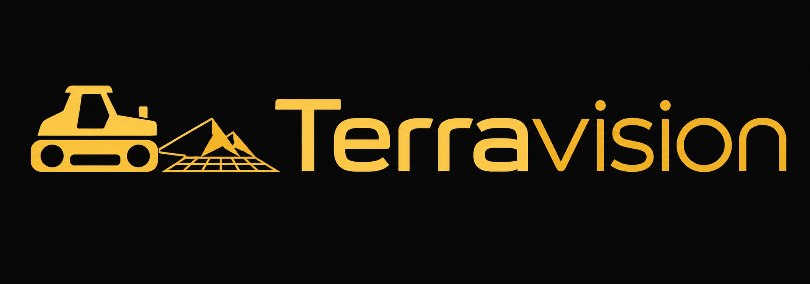
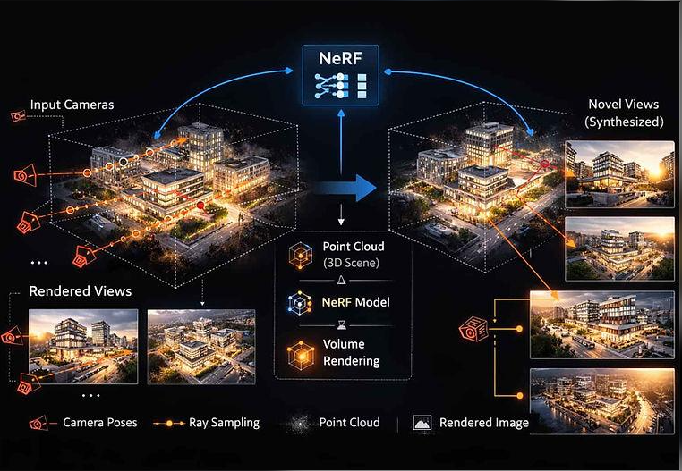
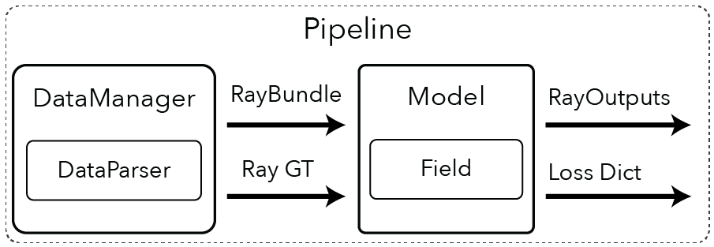
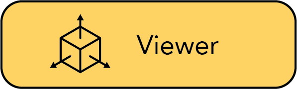

# TerraVision

<p align="center">
  <picture>
    <source media="(prefers-color-scheme: dark)" srcset="docs/_static/imgs/logo-dark.png.webp">
    
  </picture>
</p>

<p align="center">
  <strong>A modular framework for neural radiance fields, 3D Gaussian splatting, and neural scene reconstruction.</strong>
</p>

<p align="center">
  <a href="https://github.com/Pradeep-Kumar-30/Terravision/stargazers"></a>
  <a href="https://github.com/Pradeep-Kumar-30/Terravision/network/members"></a>
  
  
</p>

TerraVision provides a simplified end-to-end workflow for processing images or video, training neural scene representations, visualizing them in the browser, evaluating results, rendering camera paths, and exporting geometry.

## How NeRF Works

The diagram below illustrates the general NeRF workflow: input images and camera poses are used to learn a 3D scene representation, which can then synthesize views from new camera positions.

<p align="center">
  
</p>

## Highlights

- **NeRF and 3D Gaussian Splatting** - Train Nerfacto, vanilla NeRF, Instant-NGP, TensoRF, Splatfacto, and other included methods.
- **Custom data support** - Process images, video, 360-degree captures, Polycam, KIRI Engine, Record3D, Metashape, RealityCapture, ODM, and more.
- **Interactive web viewer** - Inspect, navigate, and export trained scenes while training or from a saved configuration.
- **Production-friendly exports** - Generate camera-path videos, point clouds, meshes, and Gaussian-splat `.ply` files.
- **Modular architecture** - Extend dataparsers, data managers, fields, renderers, models, pipelines, and optimization components.
- **Developer tooling** - Includes configuration, logging, profiling, benchmarking, evaluation, CLI completion, and Docker support.

<p align="center">
  <picture>
    <source media="(prefers-color-scheme: dark)" srcset="docs/developer_guides/pipelines/imgs/pipeline_overview-dark.png">
    
  </picture>
</p>

## Supported Workflows

| Workflow | TerraVision command |
| --- | --- |
| Process custom captures | `tv-process-data` |
| Download sample datasets | `tv-download-data` |
| Train a scene | `tv-train` |
| Open a saved or live scene | `tv-viewer` |
| Evaluate a trained model | `tv-eval` |
| Render a camera-path video | `tv-render` |
| Export meshes or point clouds | `tv-export` |

## Quick Start

### 1. Prerequisites

- Python 3.8 or newer
- NVIDIA GPU and a compatible CUDA setup recommended
- `git`
- A CUDA-capable environment for the full training and rendering workflow

TerraVision is developed primarily for Linux. Windows support is available, but can require Visual Studio Build Tools, a compatible CUDA toolkit, and activated MSVC environment variables.

### 2. Create an environment

```bash
conda create --name terravision python=3.10 -y
conda activate terravision
python -m pip install --upgrade pip setuptools
```

### 3. Install TerraVision

#### From this repository

```bash
git clone https://github.com/Pradeep-Kumar-30/Terravision.git
cd Terravision
pip install -e .
```

#### Development dependencies

```bash
pip install -e ".[dev,docs]"
```

Install a PyTorch build that matches your NVIDIA driver and CUDA toolkit before training. See [the installation guide](docs/quickstart/installation.md) for detailed Linux and Windows instructions.

### 4. Train a sample

```bash
tv-download-data terravision --capture-name=poster
tv-train nerfacto --data data/terravision/poster
```

The training process prints a local viewer URL when the web viewer is enabled. Open the URL to inspect the scene while training.

### 5. Open an existing training run

```bash
tv-viewer --load-config "outputs/.../config.yml"
```

Use `--help` on any command to discover its options:

```bash
tv-train --help
tv-train nerfacto --help
tv-export --help
```

## Use Your Own Data

Process a video or folder of images:

```bash
tv-process-data video --data path/to/video.mp4 --output-dir processed/scene
```

Or process still images:

```bash
tv-process-data images --data path/to/images --output-dir processed/scene
```

Then train the scene:

```bash
tv-train nerfacto --data processed/scene
```

For COLMAP-based image and video processing, install COLMAP and FFmpeg first. More capture workflows are documented in [Using custom data](docs/quickstart/custom_dataset.md).

## 3D Gaussian Splatting

Splatfacto trains and visualizes a Gaussian-splat scene with the same overall workflow used by NeRF methods:

```bash
tv-train splatfacto --data processed/scene
```

Export a trained Gaussian-splat scene as a `.ply` file:

```bash
tv-export gaussian-splat \
  --load-config "outputs/.../config.yml" \
  --output-dir exports/scene
```

See [Gaussian Splatting](docs/nerfology/methods/splat.md) for details.

## Render and Export

Create a renderable camera path in the web viewer, then render it from the command line:

```bash
tv-render --help
```

Export a point cloud or mesh:

```bash
tv-export pointcloud --help
tv-export tsdf --load-config "outputs/.../config.yml" --output-dir exports/mesh
tv-export poisson --load-config "outputs/.../config.yml" --output-dir exports/mesh
```

Additional examples are available in [Export geometry](docs/quickstart/export_geometry.md).

## Documentation

<table>
  <tr>
    <td align="center" width="33%">
      <br>
      <a href="docs/index.md"><strong>Full documentation</strong></a>
    </td>
    <td align="center" width="33%">
      <br>
      <a href="docs/quickstart/viewer_quickstart.rst"><strong>Viewer quick start</strong></a>
    </td>
    <td align="center" width="33%">
      <br>
      <a href="colab/demo.ipynb"><strong>Colab demo</strong></a>
    </td>
  </tr>
</table>

Useful guides:

- [Installation](docs/quickstart/installation.md)
- [Train your first model](docs/quickstart/first_nerf.md)
- [Custom datasets](docs/quickstart/custom_dataset.md)
- [CLI reference](docs/reference/cli/index.md)
- [Developer pipelines](docs/developer_guides/pipelines/index.rst)
- [Contributing](docs/reference/contributing.md)

## Project Structure

```text
TerraVision/
├── terravision/
│   ├── cameras/          # Camera representations and ray generation
│   ├── configs/          # Method, pipeline, and experiment configuration
│   ├── data/             # Dataparsers, datasets, and data managers
│   ├── engine/           # Training engine and callbacks
│   ├── exporter/         # Point-cloud, mesh, and splat exporters
│   ├── fields/           # Neural scene fields
│   ├── models/           # NeRF and Gaussian-splatting models
│   ├── pipelines/        # End-to-end data-to-model pipelines
│   ├── scripts/          # CLI tools and developer utilities
│   └── viewer/           # Interactive web-viewer integration
├── docs/                 # Sphinx and MyST documentation
├── tests/                # Test data and automated tests
├── Dockerfile
├── pyproject.toml
└── pixi.toml
```

## Development

Run the test suite:

```bash
pytest
```

Run focused lint checks:

```bash
pre-commit run --all-files
```

Please keep changes focused, include tests for behavior changes, and follow the repository's existing configuration and formatting conventions.

## Contributing

Contributions are welcome. Open an issue or pull request for:

- New NeRF or Gaussian-splatting methods
- Dataset and capture-format support
- Viewer improvements
- Export and rendering features
- Documentation and examples
- Bug fixes and performance improvements

Start with [the contributing guide](docs/reference/contributing.md).


